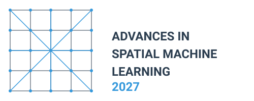

## Workshop Overview

This two-day scientific workshop aims to bring together leading researchers in the field of spatial machine learning.
Unlike many conferences that focus on showcasing achievements, our goal is to address unsolved issues and open questions, fostering innovation and collaboration.

## Key Topics

1. **Process-informed and knowledge-guided machine learning**
2. **Geospatial foundation models, embeddings and multi-model AI**
3. **Uncertainty quantification in spatial machine learning**
4. **Model generalizability in non-stationary environmental regimes**
5. **Explainable GeoAI**
6. **Open session** -- we welcome participants to propose relevant topics.

## Location and Date

The workshop will take place **18--19 March 2027 in Jena, Germany**.

The precise venue and practical information will be announced in due course.

## Program

The session topics, chairs and final timings are currently being prepared.

| Day/time         | Program                              |
| ---------------- | ------------------------------------ |
| **Wed, Mar 17**  |                                      |
| 19:00--...       | Ice-breaker (details to follow)      |
| **Thu, Mar 18**  |                                      |
| 9:00--10:30      | Welcome and introductions            |
| 10:30--11:00     | Coffee break                         |
| 11:00--12:30     | Session 1                            |
| 12:30--13:30     | Lunch                                |
| 13:30--15:00     | Session 2                            |
| 15:00--15:30     | Coffee break                         |
| 15:30--17:00     | Session 3                            |
| Evening          | Joint dinner (details to follow)     |
| **Fri, Mar 19**  |                                      |
| 9:00--10:30      | Session 4                            |
| 10:30--11:00     | Coffee break                         |
| 11:00--12:30     | Session 5                            |
| 12:30--13:30     | Lunch                                |
| 13:30--15:00     | Session 6                            |
| 15:00--15:30     | Coffee break                         |
| 15:30--17:00     | Wrap-up and future plans             |

### Posters

If you would like to present a poster related to your work in spatial machine learning, we will have a poster session area available during all coffee breaks and lunch sessions.

## Participants

The list of invited participants will be announced in due course.

## Expected Outcomes

By bringing together experts in the field, we anticipate:

- Identifying key challenges and research priorities in spatial machine learning
- Fostering collaborations between different research groups
- Developing guidelines for best practices in spatial machine learning documentation and validation
- Generating ideas for future research projects and potential funding opportunities

This workshop represents a unique opportunity to shape the future of spatial machine learning in environmental research by focusing on open questions and challenges.

## Organizers

- [Alexander Brenning, University of Jena](https://www.chemgeo.uni-jena.de/30866/brenning)
- [Hanna Meyer, University of Münster](https://www.uni-muenster.de/RemoteSensing/team/meyer/index.html)
- [Jakub Nowosad, Adam Mickiewicz University; University of Münster](https://jakubnowosad.com/)

## Supported by

